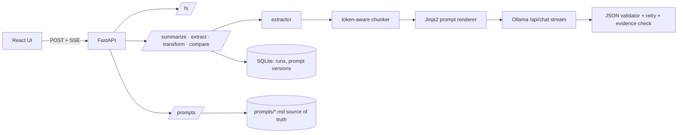

# ✨ GenAI Document Studio

Pick a document from a local folder and use a **local LLM (Ollama)** to **summarize** it (one-shot or map-reduce for
long files), **extract structured JSON** with validation and evidence checking, and **transform** it (rewrite tone,
translate English ⇄ Tamil, draft an email or report) — with **live streaming**, **editable prompt templates with
versions**, tunable sampling parameters and **A/B comparison**. No cloud, no paid APIs.

> Project 3 of 5 · teaches prompt engineering, sampling parameters, chunking for long documents, structured output and hallucination risks.

| Studio | Prompt editor | Compare |
|---|---|---|
| _screenshot placeholder_ | _screenshot placeholder_ | _screenshot placeholder_ |

## Architecture



## Prerequisites
- Python 3.11+, Node 20+
- [Ollama](https://ollama.com): `ollama serve` then `ollama pull llama3.2:3b` (any chat model works; set `OLLAMA_MODEL`).
  The UI shows the exact `ollama pull …` hint if the model is missing or Ollama is not running.

## Quick start (Windows PowerShell)
```powershell
git clone https://github.com/kamalnathmurugan14/genai-doc-studio; cd genai-doc-studio
ollama pull llama3.2:3b
cd backend
python -m venv .venv; .\.venv\Scripts\Activate.ps1
pip install -r requirements.txt
copy .env.example .env          # set DOCS_ROOT=C:/Users/you/Documents/docs (or keep ./sample_docs)
uvicorn app.main:app --reload    # http://localhost:8000/docs

cd ..\frontend                   # new terminal
npm install
npm run dev                      # http://localhost:5173
```
macOS/Linux: `source .venv/bin/activate`, `cp .env.example .env`.

## Configuration (`backend/.env`)
| Variable | Default | Meaning |
|---|---|---|
| `DOCS_ROOT` | `./sample_docs` | Folder with your documents |
| `DATA_DIR` | `./data` | SQLite (runs, prompt versions) |
| `MAX_UPLOAD_MB` / `ALLOWED_EXTENSIONS` | `25` / `pdf,docx,txt,md` | Upload limits |
| `OLLAMA_BASE_URL` / `OLLAMA_MODEL` | `http://localhost:11434` / `llama3.2:3b` | Local LLM |
| `DEFAULT_TEMPERATURE` / `DEFAULT_MAX_TOKENS` | `0.3` / `800` | Defaults (UI can override per run) |
| `CONTEXT_TOKENS` | `4096` | Context window used to choose one-shot vs map-reduce |
| `CHUNK_TOKENS` / `CHUNK_OVERLAP_TOKENS` | `1500` / `150` | Map-reduce chunking |
| `JSON_MAX_RETRIES` | `2` | Extra attempts for invalid JSON |
| `LLM_TIMEOUT_S` | `300` | Ollama read timeout |
| `PROMPTS_DIR` | `./app/prompts` | Template folder (files are the source of truth) |
| `CORS_ORIGINS` | `http://localhost:5173` | Allowed origins |

## API overview
Interactive docs at `/docs`; exported spec: [`docs/openapi.json`](docs/openapi.json). Errors: `{"error":{"code","message"}}`.

| Endpoint | Purpose |
|---|---|
| `GET /health` · `GET /models` | Service + Ollama reachability · installed models |
| `GET /fs/tree` · `POST /fs/upload` | Path-safe explorer |
| `POST /summarize` (SSE) | events `meta`, `chunk_summary`, `token`, `done {tokens_in,tokens_out,ms,run_id}`, `error` |
| `POST /extract` | `{data, valid, attempts, raw, unverified, truncated}` |
| `POST /transform` (SSE) | `action`: rewrite · translate · email · report |
| `POST /stream` (SSE) | raw prompt → tokens (connectivity test) |
| `POST /compare` | two variants on the same file |
| `GET /prompts`, `GET/PUT /prompts/{name}`, `GET /prompts/{name}/versions`, `POST /prompts/{name}/restore/{v}`, `POST /prompts/{name}/preview` | Template store |
| `GET /runs`, `GET /runs/{id}` | History |

Closing the browser tab or pressing **Stop** aborts the HTTP request to Ollama (the stream generator is closed on disconnect).

## Testing
```bash
make test                                   # or .\scripts\test.ps1
cd backend && pytest --cov=app              # 56 tests, ~94 % coverage – the real model is never called
cd frontend && npm run test:all             # eslint + tsc + vitest + build
cd frontend && npm run test:e2e             # Playwright with a scripted demo LLM
python backend/scripts/temperature_experiment.py meeting_notes.txt   # real 0.0/0.5/1.0 comparison -> docs/PROMPT_EXPERIMENTS.md
```

## Troubleshooting
- **"Cannot reach Ollama"** – run `ollama serve`; check `OLLAMA_BASE_URL`.
- **"Model … is not installed"** – `ollama pull <model>`.
- **Invalid JSON from a small model** – lower temperature, raise `JSON_MAX_RETRIES`, or use a larger model.
- **Tamil output is poor** – quality varies a lot by model; try a larger multilingual model.
- **Slow map-reduce** – chunks run one at a time on purpose; lower `CHUNK_TOKENS`/`max_tokens` or use a smaller model.

## Roadmap
Few-shot example editor · token-accurate counting · side-by-side extraction compare · export runs to JSON.

See also [Architecture](docs/ARCHITECTURE.md) · [Learning notes & prompt-engineering notes](docs/LEARNING_NOTES.md) · [Demo script](docs/DEMO.md)
